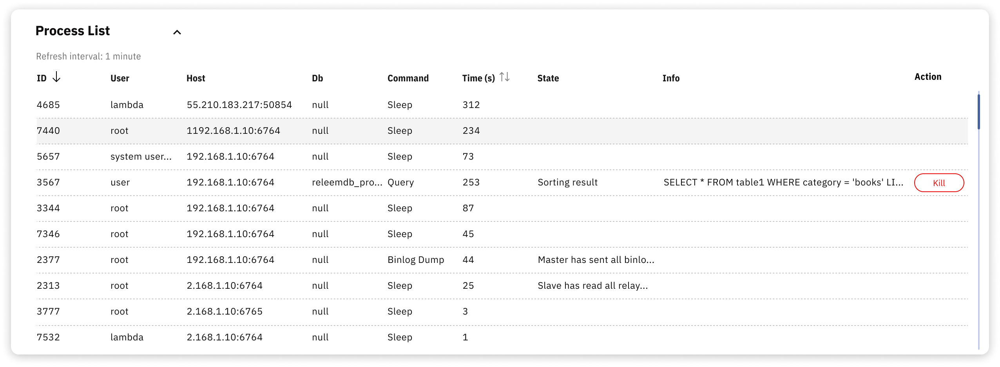

# Process List

Use Process List to inspect active MySQL connections and running queries reported for the selected server. For PostgreSQL servers, the same view is called **Activity**; see [Activity for PostgreSQL](#postgresql-activity). This centralized Dashboard view lets you investigate database activity without opening an SSH session just to view the process list.

The Process List can help you investigate:

- **Identify long-running queries** – Find queries that consume excessive time or resources, then review their workload context
- **Detect stuck processes** – Review connections that may be stuck before deciding whether termination is appropriate
- **Troubleshoot bottlenecks** – Inspect table locks and query contention as evidence of a possible bottleneck
- **Track connection activity** – Observe which applications and users are connected

The Process List shows activity to investigate; it does not by itself prove the cause of a database problem or determine whether a connection should be terminated. Confirm the workload context and application impact before you terminate a connection or change the database.

For detailed information, refer to the [Show MySQL Process List](https://releem.com/blog/show-mysql-process-list) article.

## Activity for PostgreSQL {#postgresql-activity}

For PostgreSQL servers, the **Activity** tab displays active sessions from `pg_stat_activity` with these columns:

| Column | Description |
|---|---|
| **PID** | Process ID of the server process that serves the session. |
| **User** | Database user of the session. |
| **Host** | Client address and port, or `local` for a Unix socket connection. |
| **Db** | Database the session is connected to. |
| **Backend Type** | Type of server process, such as `client backend`. |
| **Query Time** | Time in seconds since the current or last query started. |
| **State** | Session state, such as `active`, `idle`, or `idle in transaction`. |
| **Query** | Text of the current or last query of the session. |

PostgreSQL keeps up to `track_activity_query_size` bytes of query text per session; the default is `1024`. To display longer queries in full, set `track_activity_query_size` to `4096` or more and restart PostgreSQL. See [PostgreSQL settings for query data](/installation/postgresql/linux#postgresql-settings) and the [Activity troubleshooting steps](/installation/postgresql/linux#queries-in-the-activity-view-are-truncated).
